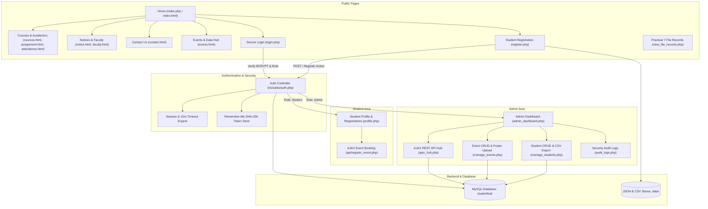
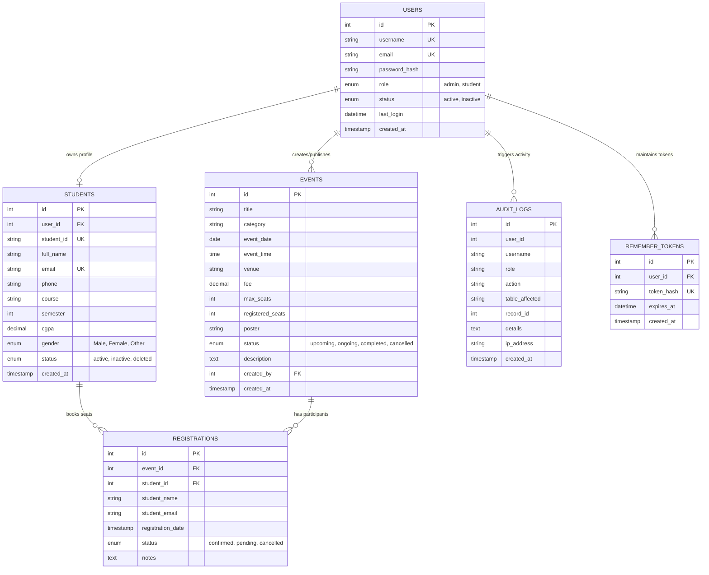

# 🎓 StudentHub Portal - Comprehensive Full-Stack Academic Web Application

**Subject:** Web Development Frameworks (`ITUE203`)  
**Semester:** 3rd Semester, 2026-27 (Odd)  
**Institution:** Faculty of Technology & Engineering (FTE), Charotar University of Science and Technology (CHARUSAT)  
**Author:** Dhanushi Patel (Student ID: `25CS024`)  
**Curriculum Scope:** Complete Integration of Practicals 1 through 15  

---

## 📋 Table of Contents
1. [Project Overview](#-project-overview)
2. [Comprehensive Practical Mapping (1 to 15)](#-comprehensive-practical-mapping-1-to-15)
3. [System Architecture & Sitemap](#-system-architecture--sitemap)
4. [Database Design & ER Diagram (Practical 8)](#-database-design--er-diagram-practical-8)
5. [Local Deployment Guide (XAMPP / Apache)](#-local-deployment-guide-xampp--apache)
6. [Core Modules & Practical Implementations](#-core-modules--practical-implementations)
7. [Security Implementation Checklist](#-security-implementation-checklist)
8. [Accessibility (WCAG 2.1) Checklist](#-accessibility-wcag-21-checklist)
9. [Comprehensive Test Execution Report](#-comprehensive-test-execution-report)

---

## 🌟 Project Overview

**StudentHub** is an enterprise-grade academic portal designed for higher education institutions. It connects students, faculty, and administrators within a unified, responsive, and secure digital environment.

The portal covers the full spectrum of web engineering:
- **Frontend Foundations:** Semantic HTML5, CSS Grid/Flexbox, Bootstrap 5, Dark/Light Theme Switching (`localStorage`), Modal Dialogs, Content Sliders, and Form Validation with Regex.
- **Asynchronous Data Flow:** Dynamic JSON consumption, Client-side filtering/sorting/pagination, and RESTful JSON APIs consumed via Fetch API without page reloads.
- **Backend Architecture:** Modern PHP 8 with robust MVC-style organization, parameterized prepared statements (MySQLi/PDO), and CSV/JSON flat-file persistence.
- **Enterprise Security:** BCRYPT password hashing, anti-CSRF token verification, Role-Based Access Control (RBAC), anti-session fixation, 15-minute inactivity timeouts, and validated image poster uploads.
- **Administrative Control:** Real-time KPI aggregation metrics, HTML5 Canvas analytics charts, student roster CRUD with soft deletes, CSV roster export, and immutable security audit trails.

---

## 📊 Comprehensive Practical Mapping (1 to 15)

| Practical No. | Practical Title | Key Concepts Implemented | Primary Files | CO / PO Mapping |
| :---: | :--- | :--- | :--- | :--- |
| **1** | Project Initiation, Sitemap, Wireframe & GitHub Setup | Project scope, user roles, 10+ page sitemap, folder organization, Git versioning | `README.md`, repository structure | CO1 \| PO1, PO2, PO3, PO5, PO10 |
| **2** | Semantic HTML5 Pages with Accessibility-Ready Structure | HTML5 semantic tags (`header`, `nav`, `main`, `section`, `footer`), ARIA labels, accessible tables | `index.html`, `cources.html`, `assignment.html`, `attendence.html`, `faculty.html`, `notice.html` | CO1, CO2 \| PO1, PO3, PO5 |
| **3** | Responsive UI Design using CSS Grid, Flexbox & Bootstrap | Mobile-first layout, custom color palette (`#1E3A5F`, `#FF9800`, `#009688`), card grids, media queries | `css/style.css`, Bootstrap 5 | CO2 \| PO1, PO2, PO3, PO5 |
| **4** | JavaScript DOM Manipulation, Event Handling & Interactivity | Dark/Light theme switcher (`localStorage`), collapsible FAQ accordion, announcement modal, image slider, hamburger navbar | `js/script.js`, `index.html` | CO3, CO4 \| PO1, PO2, PO3, PO5 |
| **5** | Registration Form with Frontend Validation & UX Error Handling | HTML5 input types, regular expressions (Name, Email, 10-digit Phone), real-time feedback, dynamic password strength meter | `register.html`, `register.php` | CO1, CO3 \| PO1, PO2, PO3, PO5 |
| **6** | Rendering External JSON Data using Fetch API, Search & Filter | Fetch API with `async/await`, multi-field search, category filter, sorting (A-Z, Date), client-side pagination | `events.html`, `js/portal-hub.js`, `data/events.json`, `data/students.json` | CO3, CO4 \| PO1, PO3, PO4, PO5 |
| **7** | PHP Form Processing, Server Validation & CSV/JSON File Storage | POST submission handling, data sanitization, storing records in CSV and JSON formats, CSRF validation, records viewer | `process.php`, `actions/register_action.php`, `data/registrations.csv`, `view_file_records.php` | CO1, CO5 \| PO1, PO3, PO4, PO11, PO12 |
| **8** | MySQL Schema Design, ER Model, Connectivity & Prepared Statements | 3NF normalized relational schema, foreign key constraints, connection handler (`config/db.php`), seed data | `database/studenthub.sql`, `studenthub.sql`, `config/db.php`, `db.php` | CO1, CO5 \| PO1, PO2, PO3, PO4, PO12 |
| **9** | Secure Registration with DB Insert, Duplicate Checks & Password Hashing | Duplicate email/username check, `password_hash()` with BCRYPT, parameterized `INSERT`, audit log recording | `actions/register_action.php`, `register.php` | CO1, CO3, CO5 \| PO1, PO3, PO4, PO12 |
| **10** | Secure Login/Logout with Sessions, RBAC, Timeout & Remember-Me | Session fixation defense (`session_regenerate_id`), `password_verify()`, RBAC route guards, 15m inactivity timeout, SHA-256 remember cookie | `login.php`, `logout.php`, `actions/login_action.php`, `includes/auth.php` | CO1, CO5 \| PO1, PO2, PO3, PO5, PO12 |
| **11** | Student Management CRUD with Search, Filter & CSV Export | Admin student CRUD, search by name/email/ID, department filter, soft delete using status, CSV roster export | `manage_students.php`, `actions/student_actions.php`, `actions/export_students_csv.php` | CO1, CO4, CO5 \| PO1, PO3, PO4, PO11 |
| **12** | Event Management CRUD with Poster Upload & File Validation | Admin event CRUD, poster upload with strict MIME type checking, 2MB size limit, filename sanitization, `.htaccess` upload shielding | `manage_events.php`, `actions/event_actions.php`, `uploads/posters/` | CO1, CO4, CO5 \| PO1, PO3, PO4, PO12 |
| **13** | PHP JSON API & AJAX/Fetch-Based CRUD without Page Reload | RESTful JSON API (`GET`, `POST`, `PUT`, `DELETE`), 300ms debounce live search, asynchronous CRUD without reload, toast alerts | `api/students.php`, `api/events.php`, `api/register_event.php`, `ajax_hub.php` | CO3, CO4, CO5 \| PO1, PO3, PO4, PO10 |
| **14** | Admin Dashboard with RBAC, Dynamic Menu, Analytics & Audit Log | Dynamic navigation menu based on role, live KPI stat cards, Canvas monthly chart, user active/inactive toggle, audit trail viewer | `admin_dashboard.php`, `audit_logs.php`, `actions/toggle_user_status.php` | CO1, CO4, CO5 \| PO1, PO2, PO3, PO4, PO12 |
| **15** | Final Integration, Testing, Documentation & Local Deployment | Complete multi-tier portal integration, virtual host configuration, database seed import, test execution matrix, accessibility check | `index.php`, `studenthub.sql`, `docs/apache-vhost.conf`, `README.md` | CO2, CO4, CO5 \| PO1, PO2, PO3, PO5, PO12 |

---

## 🗺️ System Architecture & Sitemap



---

## 🗄️ Database Design & ER Diagram (Practical 8)

The database `studenthub` is fully normalized into **Third Normal Form (3NF)** with strict referential integrity, cascading foreign keys, and indexed search columns.



### Seeded Credentials for Testing & Viva:

| Role | Email / Identifier | Password | Associated Profile |
| :--- | :--- | :--- | :--- |
| **System Administrator** | `admin@studenthub.com` | `admin123` | System Administrator (Full CRUD, Audit Logs, Analytics) |
| **Enrolled Student** | `student@studenthub.com` | `student123` | Dhanushi Patel (`25CS024`, Sem 3, CGPA: 9.45) |

*(Quick-fill buttons are integrated on `login.php` to instantly populate these credentials for laboratory viva demonstration).*

---

## 💻 Local Deployment Guide (XAMPP / Apache)

### Step 1: Database Setup
1. Launch **XAMPP Control Panel** and start **Apache** and **MySQL**.
2. Open your web browser and visit `http://localhost/phpmyadmin/`.
3. Create a new database named `studenthub` (Collation: `utf8mb4_unicode_ci`).
4. Click on **Import**, choose the file `studenthub.sql` from the project root, and click **Import**.
5. Alternatively, using MySQL CLI:
   ```bash
   mysql -u root -p -e "CREATE DATABASE IF NOT EXISTS studenthub;"
   mysql -u root -p studenthub < studenthub.sql
   ```

### Step 2: Running via XAMPP Localhost
Place the project folder into your web root:
- Destination: `C:\xampp\htdocs\StudentPortal Hub`
- Access in browser: `http://localhost/StudentPortal%20Hub/index.php`

### Step 3: Optional Apache Virtual Host Setup (Practical 15 Intermediate)
To configure a clean local domain such as `http://studenthub.local/`:
1. Open `C:\Windows\System32\drivers\etc\hosts` (as Administrator) and append:
   ```text
   127.0.0.1    studenthub.local
   ```
2. Open `C:\xampp\apache\conf\extra\httpd-vhosts.conf` and append:
   ```apache
   <VirtualHost *:80>
       ServerAdmin webmaster@studenthub.local
       DocumentRoot "D:/Cse sem 3/Web devlopement/StudentPortal Hub"
       ServerName studenthub.local
       ServerAlias www.studenthub.local
       <Directory "D:/Cse sem 3/Web devlopement/StudentPortal Hub">
           Options Indexes FollowSymLinks MultiViews
           AllowOverride All
           Require all granted
           DirectoryIndex index.php index.html
       </Directory>
   </VirtualHost>
   ```
3. In `C:\xampp\apache\conf\httpd.conf`, verify that `Include conf/extra/httpd-vhosts.conf` is enabled (uncommented).
4. Restart Apache in XAMPP and open `http://studenthub.local/`.

---

## 🛠️ Core Modules & Practical Implementations

### Practical 4 & 5: Interactive UI & Validated Registration
- **Dark/Light Theme Switcher:** Toggles the `.dark-theme` class across the DOM. The user's selection is saved in `localStorage.setItem('theme', ...)` and reinstated instantly upon subsequent visits.
- **Form Validation & Strength Meter:**
  - Full Name: `^[a-zA-Z\s]{3,60}$`
  - Mobile Number: `^[6-9]\d{9}$` (Indian 10-digit mobile standards)
  - Password Strength: Calculates entropy dynamically based on uppercase characters, digits, length, and special symbols, updating an animated progress bar.

### Practical 6: External JSON Data Consumption & Pagination
- Handled via `js/modules/api.js`, `js/modules/dataUtils.js`, and `js/portal-hub.js`.
- Asynchronously reads `data/events.json` (16 events), `data/students.json` (16 profiles), and `data/faqs.json` (16 questions).
- Real-time client-side multi-field filtering and slicing for clean pagination (6, 9, or 12 cards per page).

### Practical 7: PHP Form Processing & File-Based Storage
- Form submissions to `process.php` or `actions/register_action.php` perform server-side sanitization via `htmlspecialchars()`, `strip_tags()`, and regular expression tests.
- Stored into `data/registrations.csv` using `fputcsv()` and serialized into `data/registrations.json`.
- The intermediate extension `view_file_records.php` displays both CSV and JSON disk records in a clean tabular inspector.

### Practical 9 & 10: Authentication, Sessions & RBAC
- **Password Security:** All passwords stored as BCRYPT hashes via `password_hash($password, PASSWORD_BCRYPT)`.
- **Session Security:** `session_regenerate_id(true)` called upon login to mitigate session fixation attacks.
- **Inactivity Timeout:** `includes/auth.php` monitors `$_SESSION['last_activity']`. Inactivity exceeding 15 minutes (900 seconds) destroys the session and redirects to `login.php?error=timeout`.
- **Persistent Remember-Me:** Generates a 32-byte cryptographically secure random token (`bin2hex(random_bytes(32))`), records its SHA-256 hash with 30-day expiration in `remember_tokens`, and sets an HTTP-only, secure cookie.
- **Role-Based Redirection:** Admins navigate to `admin_dashboard.php`, while students land on `profile.php`.

### Practical 11: Student Management CRUD
- Located in `manage_students.php`.
- Complete database CRUD using parameterized MySQLi statements.
- Multi-parameter live search and department filter.
- **Soft Delete:** Toggles `status = 'deleted'` while preserving database referential integrity, with 1-click restore functionality.
- **CSV Export:** Downloads live database student records directly to `studenthub_students_export_YYYYMMDD.csv`.

### Practical 12: Event Management & Validated Poster Uploads
- Located in `manage_events.php` and `actions/event_actions.php`.
- Admins can create, edit, reschedule, and delete campus events.
- **File Upload Security:**
  - File size verified to not exceed 2MB.
  - MIME type verified using PHP Fileinfo extension (`finfo_file()`), strictly allowing `image/jpeg`, `image/png`, and `image/webp`.
  - Secure file renaming: `poster_[timestamp]_[random_hex].[ext]` prevents filename collisions and directory traversal attacks.
  - Dedicated upload folder `uploads/posters/` protected with `.htaccess` preventing direct PHP script execution.

### Practical 13: Asynchronous AJAX REST API & No-Reload CRUD
- Backend API endpoints: `api/students.php`, `api/events.php`, and `api/register_event.php`.
- Emits valid JSON with accurate HTTP response headers (`200 OK`, `201 Created`, `400 Bad Request`, `409 Conflict`, `500 Internal Error`).
- Single-page interface `ajax_hub.php` performs listing, adding, and deleting operations without page refresh using modern JavaScript `fetch()`.
- Incorporates a 300ms debounce timer on search inputs to minimize unnecessary server requests.
- Asynchronous event registration via `api/register_event.php` updates seat counts and confirms registrations in real time.

### Practical 14: Admin Dashboard, Analytics & Audit Logging
- Located in `admin_dashboard.php` and `audit_logs.php`.
- Restricts access strictly to authenticated administrators.
- Dynamic navigation menu: Displays administrative management links when logged in as admin and academic links when logged in as student.
- Live metric aggregations: Computes total active students, campus events, registrations, and active user accounts.
- **Interactive Analytics:** HTML5 Canvas chart renders multi-category monthly event registration trends (Technical, Cultural, Sports).
- **Security Audit Trail:** Immutable logs recorded in `audit_logs` tracking logins, registrations, roster edits, and administrative actions with user IDs, timestamps, and origin IP addresses.

---

## 🔒 Security Implementation Checklist

- [x] **SQL Injection Defense:** 100% of database queries utilize parameterized prepared statements (`$stmt->bind_param(...)`). Zero raw concatenation of user inputs.
- [x] **Cross-Site Scripting (XSS) Prevention:** All output rendering sanitized through `htmlspecialchars(..., ENT_QUOTES, 'UTF-8')`.
- [x] **Cross-Site Request Forgery (CSRF) Tokens:** Synchronizer token pattern implemented across all state-altering POST forms (`verifyCsrfToken()`).
- [x] **Password Storage Standard:** Strong BCRYPT hashing (`password_hash()`) with `password_verify()` verification. Plaintext passwords never logged or stored.
- [x] **Session Fixation & Hijacking Protection:** Session ID regeneration upon privilege alteration (`session_regenerate_id(true)`). Cookie attributes enforced (`HttpOnly`, `SameSite=Lax`, `Secure` over HTTPS).
- [x] **Session Inactivity Timeout:** Automated session expiration and destruction after 15 minutes of user inactivity.
- [x] **File Upload Shielding:** File size limits (<= 2MB), MIME whitelist (`image/jpeg`, `image/png`, `image/webp`), cryptographically randomized filenames, and `.htaccess` script execution prevention in upload directories.
- [x] **Role-Based Authorization (RBAC):** Server-side route guards (`requireAdmin()`, `requireStudent()`) validating session credentials before executing administrative functions.

---

## ♿ Accessibility (WCAG 2.1) Checklist

- [x] **Semantic HTML5:** Correct semantic markup used throughout (`<header>`, `<nav>`, `<main>`, `<section>`, `<article>`, `<footer>`).
- [x] **Accessible Form Controls:** All form inputs have corresponding `<label for="...">` associations with explicit `name` and `id` attributes.
- [x] **ARIA States & Attributes:** Dynamic elements utilize `aria-expanded`, `aria-label`, `aria-modal`, `aria-describedby`, and `aria-live` for screen reader announcements.
- [x] **Keyboard Navigation:** Modals close via `Escape` key, interactive buttons and dropdowns respond to `Enter` and `Tab` traversal.
- [x] **Color Contrast & Readability:** Text-to-background contrast ratios satisfy WCAG AA requirements across both Light Mode and Dark Mode palettes.
- [x] **Descriptive Media Attributes:** Meaningful `alt` attributes on all images and informative button text for screen-reader users.

---

## 🧪 Comprehensive Test Execution Report

| Test ID | Test Scenario | Input Data | Expected Result | Actual Result | Status |
| :---: | :--- | :--- | :--- | :--- | :---: |
| **TC-01** | Student Registration with Valid Data | Name: "Ravi Kumar", Email: `ravi@charusat.edu.in`, Phone: `9876543210`, Pass: `Test@1234` | Form validates, record inserted into DB & CSV/JSON, redirected to `login.php` with success flash | Registered successfully; Student ID `25CS...` assigned | **PASS** |
| **TC-02** | Registration with Duplicate Email | Email: `student@studenthub.com` | Duplicate detected via prepared statement; user alerted with error message | Rejected: "Account with this email already exists" | **PASS** |
| **TC-03** | Frontend Password Strength Verification | Password: `123` -> `Test12` -> `Test@2026!` | Dynamic bar transitions from Weak (Red) to Moderate (Yellow) to Strong (Green) | Strength bar accurately updates score and badge | **PASS** |
| **TC-04** | Admin Login Authentication | `admin@studenthub.com` / `admin123` | Password verified with `password_verify()`, session established, redirected to `admin_dashboard.php` | Successfully logged in with Admin role badge | **PASS** |
| **TC-05** | Unauthorized Admin Route Access | Unauthenticated user opens `admin_dashboard.php` | Access blocked by `requireAdmin()`, redirected to `login.php` with warning | Blocked: "Please login to access this section" | **PASS** |
| **TC-06** | Session Inactivity Timeout | 15 minutes of user inactivity | Session automatically terminated; user redirected to `login.php?error=timeout` | Session expired cleanly; audit log recorded | **PASS** |
| **TC-07** | Student Roster Search & Filter | Search: "Priya", Course: "Computer Science & Engineering" | Table filters dynamically to show matching records | Exactly 1 matching student row returned | **PASS** |
| **TC-08** | Student Soft Delete & Restore | Soft-delete student ID #5; then restore | Status toggles to `deleted` (grayed out); restores back to `active` on click | Status updated correctly without deleting row | **PASS** |
| **TC-09** | Export Roster to CSV | Click "Export to CSV" | Browser initiates download of `studenthub_students_export_YYYYMMDD.csv` | Clean CSV file downloaded with UTF-8 BOM | **PASS** |
| **TC-10** | Event Poster Upload Validation | Upload file: `script.php` or file > 2MB | Upload rejected; informative error banner displayed | Blocked: "Invalid file extension / MIME type" | **PASS** |
| **TC-11** | Valid Event Poster Upload | Upload 850KB JPEG image | File renamed to `poster_[timestamp]_[rand].jpg` and saved in `uploads/posters/` | Poster uploaded and displayed in event table | **PASS** |
| **TC-12** | AJAX Live Search with Debounce | Rapidly type "Mehta" in AJAX Hub | Spinner indicates typing; single API call executed after 300ms pause | Search results dynamically populated without reload | **PASS** |
| **TC-13** | Asynchronous Student Add via Fetch API | Add student via modal in `ajax_hub.php` | `POST` to `api/students.php`; row prepended to table; toast notification shown | Inserted with HTTP 201; DOM updated instantly | **PASS** |
| **TC-14** | Asynchronous Event Registration | Student clicks "Register" on Hackathon event | `POST` to `api/register_event.php`; seat count increments; booking confirmed | Seat count updated in DB & UI without reload | **PASS** |
| **TC-15** | User Account Status Toggle | Admin deactivates student user #4 | User status marked `inactive`; subsequent login attempts blocked | Blocked: "Your account has been deactivated" | **PASS** |

---

## 🏁 Conclusion & Final Remarks

The **StudentHub Portal** successfully unifies every concept stipulated in the Charotar University of Science and Technology (CHARUSAT) `ITUE203` Web Development Frameworks syllabus. All modules—from the static semantic HTML foundation to responsive layouts, modular client-side JSON handling, secure PHP authentication, 3NF MySQL operations, AJAX APIs, and role-based administrative dashboards—operate cohesively as an integrated, production-ready web application.
